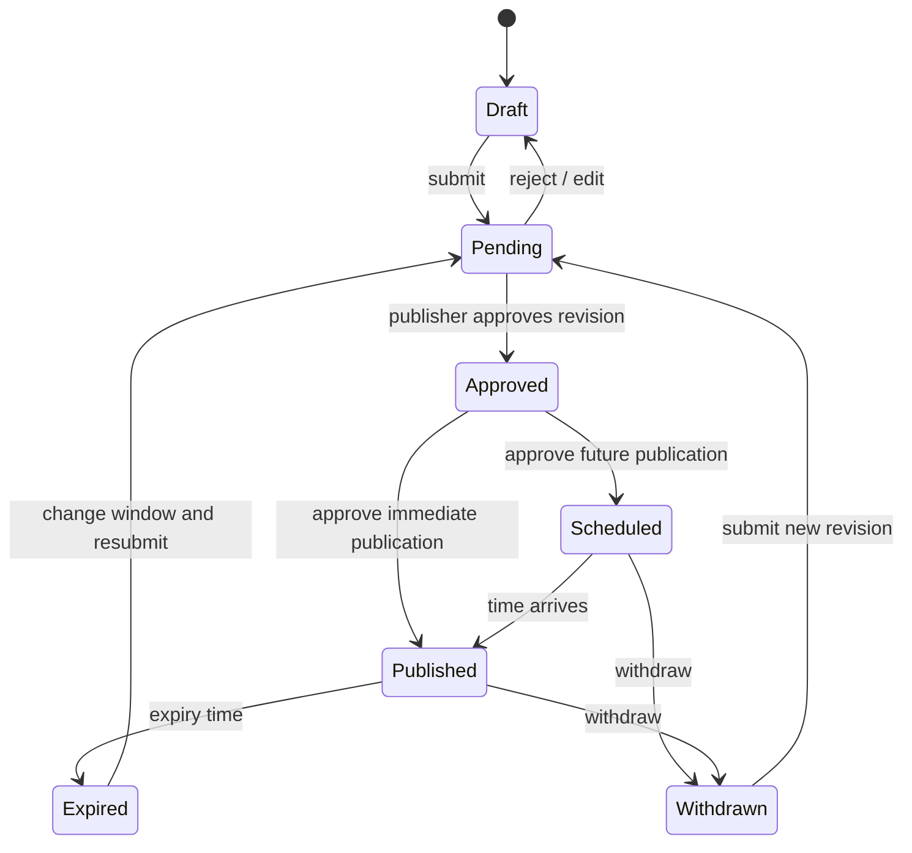

# A3 — Announcement functional specification

## Verified baseline

`features/announcements/actions.ts` creates/edits/restores with `announcements.edit`, setting `publish_at`; migration 026's public RLS allows `(publish_at IS NULL OR publish_at <= now()) AND expires_at > now()`. Thus an edit-only user can make an item publicly eligible. Migration 025 also grants update with edit permission; hiding a button alone cannot fix it. Migration 027 orders rows; `fetchAnnouncements` pages scheduled/expired and loads the complete live rotation for reorder/preview. `features/announcements/components` and `modals` provide editor, carousel, image upload, tabs, inspector and restore; `app/dashboard/announcements` provides page/loading/error. Public website `src/lib/public-content.ts:getAnnouncements` independently filters time and orders `display_order,id`; staff RLS adds visibility, so staff-cookie public requests need explicit published filtering. No approval or draft exists. Baseline announcement table DDL may predate local migrations: inspect deployed schema rather than infer constraints from types alone. Existing image/order and public presentation must remain.

| Capability / actor | Current | Required outcome |
| --- | --- | --- |
| Create/edit / `announcements.edit` | Existing, can publish | save candidate privately; never expose candidate before approval. |
| Submit/reject / editor/publisher | Missing | revision-specific review and reason. |
| Approve, publish, schedule, withdraw / `announcements.publish` | Permission defined but current writes use edit | enforce at SQL and action level; approved exact content/time. |
| Expiry / clock | Existing derived | keep read-time expiry, no cron. |
| Reorder / `announcements.edit` | Existing RPC 027 | preserve live display order; confirm permission for ordering a public rotation. |
| Delete / `announcements.delete` | Physical delete exists | preserve behavior pending decision; history retention and audit must be reconciled before migration. |

## State model

Use two independent dimensions: candidate revision review `draft | pending | approved | rejected` and public placement `unpublished | scheduled | live | withdrawn | expired` (last three time-derived from an approved published revision plus current time, except explicit withdrawal). The user chose to withdraw an announcement when material edits await approval. Preserve the previously approved revision as history, while public visibility is withdrawn until the edited revision is approved. Existing public rows remain visible as grandfathered content without inventing a historical human approval. Approval binds exact title, description, media URL/alt, CTA URL/caption, publish and expiry times and any other publicly displayed field, plus revision. Reorder is separate from per-item content approval unless business rules say otherwise. Scheduling is not approval.



| Entity | Current state | Action/trigger | Preconditions | Actor/permission | Next state | Consequences | Failure behavior |
| --- | --- | --- | --- | --- | --- | --- | --- |
| Candidate | none | create draft | required shape as draft permits | `announcements.edit` | draft | candidate only, no public read; audit | validation/no insert |
| Candidate | draft/rejected | edit | version matches | edit | draft | content changed, any prior candidate approval invalidated | conflict no write |
| Candidate | draft | submit | publishable content, valid window | edit | pending | freeze revision and notify reviewer | invalid/stale unchanged |
| Candidate | pending | reject | revision matches, reason | publish | rejected | preserve candidate, audit reason | stale/denied |
| Candidate | pending | approve & publish/schedule | revision matches, time window valid | publish | approved + live/scheduled | atomically set public revision, consent and dates; local audit | conflict/validation no partial publish |
| Public revision | scheduled | scheduled instant | approval and window valid | clock/read | live | anonymous visibility, no mutation or cron | cache must respect boundary |
| Public revision | live | expiry | now >= expires | clock/read | expired | public query excludes; history preserved | cache may delay unless freshness controlled |
| Public revision | live/scheduled | withdraw | expected revision | publish | withdrawn | immediately revoke public eligibility, keep content; audit | race/conflict; external cache limitation |
| Candidate/public | any | material edit | candidate/version | edit | new draft; previous public version withdrawn | invalidate approval, withdraw from public view and retain prior version in history | conflict; no public draft leak |
| Withdrawn/expired | submit new window | valid new revision | edit then publish | pending then scheduled/live | reapproval required, history remains | validation/stale |
| Public scheduled | reschedule | altered publication/expiry | edit then publish | pending then approved | new time requires fresh approval; old public policy subject to decision | no silent approval bypass |
| Any | delete | confirm retention policy | delete | deleted or archived (decision) | existing physical deletion conflicts with preservation | do not decide silently |

## Screens, navigation and wireframe

```text
Announcements [Live | Scheduled | Drafts & review | Withdrawn | Expired] [+ New]
Live rotation (drag to reorder)      Inspector: selected announcement
  [thumbnail] [title] [Live]         Public version / candidate draft
                                      [Edit draft] [Withdraw]
Editor: content, image, links       Publication: [date/time] [expiry] timezone
[Save draft] [Submit for review]     Review: [Approve & publish/schedule] [Request changes]
```

| Screen | Goal / state and displayed data | Inputs and CTA → transition | Permission / validation / feedback |
| --- | --- | --- | --- |
| List + rotation | Existing order/preview, live/scheduled/draft/review/withdrawn/expired, pages/count | select/reorder, new | view/edit; stable pagination outside live rotation; empty/loading/errors. |
| Editor + publication settings | Create candidate while showing current public version | content/image/links/window, save, submit | edit; valid URL/image/date and timezone, unsaved warning, revision conflict. |
| Review panel | Compare exact public candidate, media, CTA, publication and expiration | approve+publish/schedule, reject reason | publish; version-guarded; pending/approved/rejected states. |
| Inspector/history | Show public/candidate, window, approval actor, withdrawal and expiry | withdraw, resubmit, restore/reapprove | view/publish/edit as appropriate; irreversible public visibility warning; retain history. |

All controls inherit common accessibility/state requirements. Public site must use only approved currently active revision, even with a staff cookie, and preserve existing carousel rendering/order. A cross-deployment invalidation or bounded-cache strategy must ensure immediate withdrawal and time-based activation/expiry meet an agreed freshness SLA; admin `revalidatePath` is not cross-deployment invalidation. Inspect actual website caches before selecting a mechanism.

## Data, contracts, migration

| Field | Purpose / type / owner | Update, constraint, query, retention |
| --- | --- | --- |
| Existing announcement identity, display_order | Stable identity and live ordering | Preserve existing IDs/order; 027 reorder semantics; index to support active public order only if query plan justifies. |
| Revision ID, parent FK, monotonically increasing revision | Immutable approved content/window and candidate history | Editors create new revision; previous published revision unchanged; unique parent/revision; FK restrictions and version check. |
| Content, media, links, `publish_at`, `expires_at` | Exact public and review payload | Validate pair/window and URLs; `publish_at` may use an explicit immediate decision, never NULL-as-unapproved; preserve existing media URLs. |
| Review decision, approver, time, reason | Revision approval provenance | Only publisher RPC changes; immutable decision history; no approval of stale revision. |
| Current candidate and public revision references, withdrawn state, version | UI and publication source of truth | Transactionally update references; validate ownership/same parent; public RLS/view only exposes current approved time-eligible revision. |
| Optional event reference | Future association, not automation | Nullable FK and delete semantics to decide; may defer entirely until approved. |

Use minimal migration after inspecting actual baseline: preflight legacy content/windows/IDs; create revision schema and backfill without changing public appearance, subject to explicit grandfathering decision; atomically replace anonymous RLS/read path and direct write grants with permission-checked mutation RPCs. Prevent edit-only users from writing live fields or approval via direct SQL/API. Design policy for legitimate scheduled and public legacy rows without pretending a historical human approval occurred; audit migration attribution. RLS and grants must protect revision tables and the public projection. Public reader and admin must be coordinated to avoid downtime or draft leakage; test old/new combinations and rollback plan. `saveDraft`, `submit`, `approveAndPublish`, `reject`, `withdraw`, `reorder` use common inputs/results and transactions; unique request IDs where replay can cause duplicate transitions. Audit does not include content/PII.

## Scenarios and traceability

Editor changes live item → `announcements.edit` → new draft remains private; approved current version is withdrawn while review is pending → reviewer sees exact content and window → `announcements.publish` approves matching revision → pointer changes atomically → cache refreshed/expiry enforced. If editor changes draft while reviewer acts, approval conflicts. If withdrawal races publication, revision/lock guards give one deterministic result; no public draft leakage.

| Requirement → capability/state/transition → consequence → screen → data/API → test |
| --- |
| Edit cannot publish → draft save → private candidate → editor → revision+permissions → authenticated direct-write bypass and RLS tests. |
| Exact approval → submit/approve/reject → selected revision becomes public → review panel → approval subject and version → content/media/link/time changes, stale races and denied roles. |
| Schedule/expire/withdraw → time and manual transitions → public filtering → list/inspector → public projection → boundary, staff cookie, cache and unpublished history. |
| Preserve order/images → reorder/live → stable carousel → rotation → existing order/image data → migration and public reader regression. |
| Optional event link → local association only → no trigger → settings → nullable FK → **defer until association and deletion policy approved**. |
