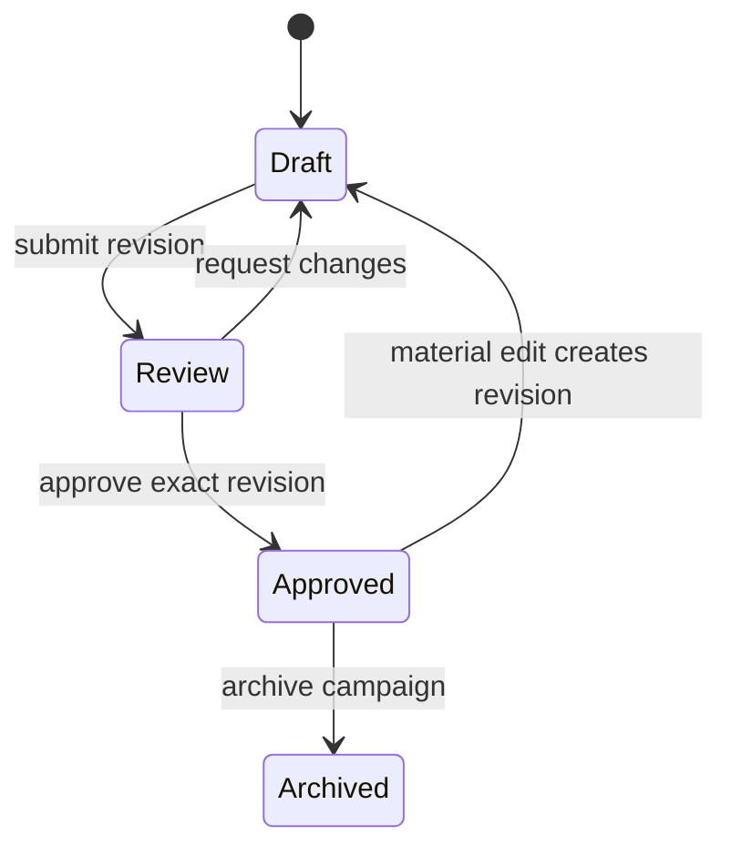

# A2 — Email campaigns functional specification

## Baseline and decisions

No general campaign, template, subscriber audience, automation, approval or email delivery module was found in `app`, `features`, `actions`, `supabase/migrations`, or package dependencies. `features/team/actions.ts` uses Supabase Auth invitations; `features/communityFeedback` has `mailto:` links, neither is campaign infrastructure. Unknown external provider accounts and credentials were not inspected. Phase A's proposed increment stages content locally only: no provider dependency, sync, activation, enrollment or sending without separate approval.

## Provider and builder feasibility (documentation researched 2026-11-20)

| Capability | MailerLite | Mailchimp | Verification / limitation |
| --- | --- | --- | --- |
| Create automation, steps, HTML | [Automations API](https://developers.mailerlite.com/api/automations), [steps API](https://developers.mailerlite.com/api/automation-steps) document draft creation, steps and a separate HTML endpoint; steps require inactive automation. | [Customer Journey API trigger](https://mailchimp.com/developer/marketing/api/customer-journeys/create-journey-step-action-trigger/) requires a starting point/step created in the application. | Full programmatic Mailchimp flow creation/HTML not established; do not assume. Confirm exact endpoint permissions and intended account plans. |
| Dates / reminders | [Triggers API](https://developers.mailerlite.com/api/automation-triggers) and [help](https://www.mailerlite.com/help/how-to-set-up-automation-triggers) document subscriber date fields, before/on date and daily 04:00 UTC eligibility; delay steps have elapsed-date behavior. | API-triggered entry documented; full relative-date configuration via API unverified. | Test 7/3/0 day, after-event, time zone, lateness and changes end-to-end. A single subscriber field stores one value: using it for overlapping event registrations would overwrite one registration's timing; event-specific fields/groups or different workflows are possible designs, not proven safe or scalable. |
| Registration confirmation / enrollment | Group join or direct add to active automation documented; direct add accepts only existing active subscribers, skips unmatched and already-enrolled, and enqueues asynchronously. [API](https://developers.mailerlite.com/api/automations) | API-triggered journey for a contact is documented. | Confirm consent, double opt-in, concurrent registrations, re-entry, delayed enrollment and duplicate behavior in intended account. API acceptance does not prove enrollment or send. |
| Enable / change active | API documents enable/disable, but modifying steps requires inactive automation. | Provider UI lifecycle; details and API support need verification. | Define in-flight subscribers, pause/edit/reactivate and reconciliation before approval. |
| Plans / reporting | [Multiple triggers](https://www.mailerlite.com/help/how-use-multiple-automation-triggers) are Power-plan-only; reports API listed. | Plan restrictions and granular reporting not established. | Verify cost, availability, webhooks and outcome granularity on WMCC account; no claim of complete reporting. |

Builder recommendation: prototype [Maildeno editor and renderer](https://docs.maildeno.com/) first. Its documentation describes MIT self-hosted editor, structured JSON, offline HTML/MJML export, images, links/buttons, responsive previews and accessibility checks; the [changelog](https://docs.maildeno.com/changelog) shows ongoing releases. React/Next integration through its client-side custom element is plausible, not tested in this repository; validate React 19/Next 16, CSP, keyboard accessibility, XSS and generated HTML across email clients, image hosting, branding and package license at pinned version. Accessibility checker and preview are not proof of accessible output. The precise project meant by **Open Email** could not be reliably identified; its license, maintenance, compatibility and functionality remain unverified. Ask for its URL. Do not select by name alone; evaluate a maintained rich-text fallback if builder tests fail. Store schema-versioned editable source separately from sanitized rendered HTML and renderer version; sandbox untrusted HTML preview and validate URLs/assets server-side. Rendering must be reproducible for approved revisions.

## Entities, state dimensions and transition matrix

Campaign, communication, template, immutable approval revision, provider sync/activation and delivery are distinct. Persist campaign lifecycle `draft | ready | archived` (ready means approved and locally staged, not active). Communication editing `draft | in_review | approved` applies per revision. Provider `not_connected | unsynced | syncing | synced | failed | unknown`; activation `inactive | activation_pending | active | deactivation_pending | unknown`; delivery `not_started | queued | accepted | delivered | failed | unknown` is provider-reported and unavailable until integration. A provider may not expose per-recipient delivery; never fabricate it. These dimensions do not authorize one another.



| Entity | Current state | Action/trigger | Preconditions | Actor/permission | Next state | Consequences | Failure behavior |
| --- | --- | --- | --- | --- | --- | --- | --- |
| Template | active | save revision | valid source; expected version | proposed `email.edit` | active | new version; existing communication snapshot unchanged | stale conflict |
| Template | active | archive | no destructive removal of referenced revision | `email.edit` | archived | no new selection; history remains | denied/conflict |
| Campaign | draft | create/edit | standalone or optional event reference, revision | `email.edit` | draft | local config only | validation/conflict |
| Communication | draft | submit | subject, sender, content, audience and trigger valid | `email.edit` | in_review | freeze revision for review | validation/conflict |
| Communication | in_review | approve / reject | exact current revision; permitted actor | `email.approve` proposed | approved / draft | audit decision; reject reason; no external operation | stale/denied |
| Communication | approved | edit content/config | compare material fields | `email.edit` | draft | only changed communication loses approval, retain prior snapshot | no partial write |
| Campaign | draft | stage ready | intended enabled communications approved; config valid | `email.edit` or separate stage permission to decide | ready | local provider-ready intent, no sync/send | failure leaves draft |
| Campaign | ready | activate/deactivate | **future provider increment**; approvals and feasibility | proposed `email.publish` | external state | provider operation after commit; accepted ≠ delivered | unknown → reconciliation; no blind retry |
| Delivery | provider pending | report | verified provider callback/query | trusted provider adapter | delivered/failed/unknown | preserve report/time; partial outcomes | unsupported detail remains unknown |

No automated confirmation or reminder is sent by Phase A staging. Trigger configuration expresses intent (`registration`, `relative_to_event`, `absolute`, `manual`), offset, timezone, audience and late-entry policy. A sequence is configured communications ordered for presentation, not proof a provider can implement it. No default reminder is mandatory. All material fields (source/HTML revision, subject/preheader, sender/reply-to, audience version, trigger/timing and relevant shared campaign settings) belong to approval fingerprint. Shared setting changes invalidate only impacted communications after authoritative comparison. Draft changes never activate or send.

## Screens and journeys

```text
Email > Campaigns [New campaign]       [Draft | Ready | Archived]
Campaign: Community event  [Settings] [Sequence] [Provider status]
Sequence: [Confirmation] [7-day reminder] [+ Add communication]
          Draft / Needs review / Approved    [Edit] [Review]
Editor: [Blocks] | visual canvas | [Settings: subject, sender, audience, trigger]
                  [Desktop/Mobile preview] [Save draft] [Submit for review]
Review: exact content, sender, audience, timing; [Approve] [Request changes]
Provider: Not connected — staged locally. No messages are sent.
```

| Screen | Goal, visible states/data | Inputs / transition | Permission, validation, feedback/recovery |
| --- | --- | --- | --- |
| Campaign list/settings | Locate standalone/event-associated draft, ready, archive | create/edit/archive | `email.view/edit` proposed; expected revision; empty/forbidden and confirmation. |
| Workspace sequence tab | Configure communications and order | add/edit/remove, trigger offsets and audience reference; submit | `email.edit`; validate required fields and changed revision, save state, unsaved navigation guard. |
| Builder/template library | Reuse source, brand, images, links, preview | save template, copy template to communication, preview | edit permission, version snapshot; builder load failure retains recoverable last save, sanitized previews. |
| Review panel | Compare exact revision, pending/approved/rejected | approve/reject with reason | `email.approve`; stale revision conflict; keyboard focus, audit and distinct pending/approved. |
| Provider status/history tab | Show not connected, staged, later sync/active/error/unknown | none in staging; later separately approved activation/reconcile | view permission; do not imply readiness equals delivery. |

## Data dictionary and contracts

All proposed tables require approved permissions, RLS, actor/timestamps/version and retention policy. `email_templates`: UUID, name, schema-versioned source JSON, renderer version, current revision, archived flag; source owned by email editors, history by immutable revisions. `email_campaigns`: UUID, name, optional nullable event ID, lifecycle and version, creator; delete/archive semantics preserve approved history. `email_communications`: UUID/campaign FK, sequence order, type label, subject/preheader, sender/reply-to, template snapshot/source and derived sanitized HTML, audience reference/version, trigger kind/offset/timezone/late-entry setting, revision, review state; constraints guard required staged fields. `email_approvals`: communication FK, revision/fingerprint, decision, actor and time; a separate history record is justified by exact approval and audit. HTML is a reproducible artifact, source is authoritative; storing exact rendered HTML for each approved version is justified for review/reconciliation if renderer changes. Audience references must be authorization-checked and do not create a duplicate subscriber database. Optional provider mapping/state and delivery report tables are **deferred** until concrete approved provider capabilities; schema is not a claim of current provider support. Index campaign lifecycle/updated/id, communication campaign/order, and approval communication/revision; inspect plans and bound all lists. Do not log contact data; establish retention and deletion policy before launch.

Operations: `saveTemplate(source,expectedVersion)`, `saveCampaign(settings,expectedVersion)`, `saveCommunication(content,trigger,audience,expectedVersion)`, `submit`, `approve/reject(expectedRevision)`, `stageCampaign(expectedRevision)` return typed common result; transactionally validate authorization and approval subject. No external call in these operations. Future adapters own provider idempotency, capability validation, callback verification and audit; never embed provider date conventions in trigger intent.

## Scenario and traceability

Editor creates campaign and standalone confirmation → proposed `email.edit` → local draft plus communication → preview → submit → authorized reviewer approves exact revision → stage → screen explicitly says not connected/no send. Editing sender afterwards atomically invalidates only relevant approval; stale concurrent approval fails. Provider integration, if later approved, must reconcile timeout after acceptance instead of duplicate sync/send.

| Requirement → capability/state/transition → consequence → UI → data/API → test |
| --- |
| Reusable visual source → template revision/save → snapshot unchanged → library/builder → source+renderer → save/load, HTML/client and XSS/keyboard tests. |
| Multi-message configurable sequence → communication draft/save → no send → sequence/editor → trigger+audience → offsets, standalone, invalid late policy. |
| Exact separate approval → review/approve/edit → changed-only invalidation → review → revision/fingerprint → races and denied users. |
| Provider staging vs activation → ready only → no provider calls → status → local operation → mock no network. |
| Automation, concurrent registrations, delivery → future provider contract → provider-managed → status/history → adapter/report → **blocked until feasibility, provider/plan and separate approval**. |
