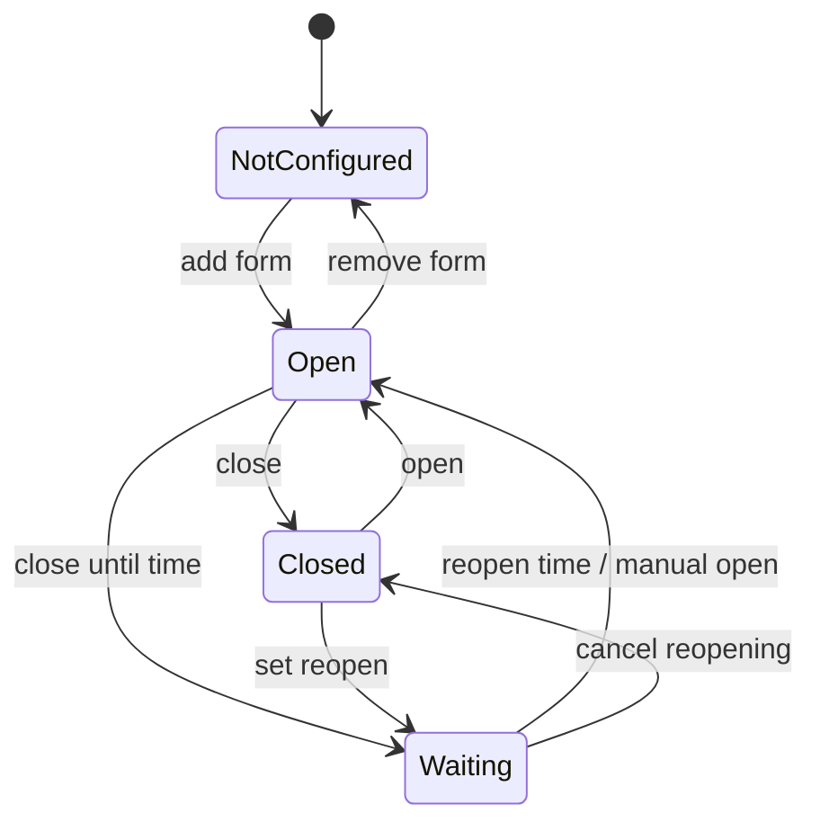

# A1 — Registration functional specification

## Baseline and capability inventory

`supabase/migrations/039_event_registrations.sql` has one `event_id` and one JSONB array of arbitrary object submissions; 045's invoker RPC validates page bounds, checks `events.view` and returns a slice and count. `app/dashboard/events/[eventId]/registrants/page.tsx`, `features/events/lib/registrants.ts` and `RegistrationFields.tsx` implement paginated list/recursive details. Cognito ID is persisted and mutually exclusive with CTA in 033 and `BaseEventForm.tsx`; public `wmcc-website/src/app/events/[slug]/page.tsx` embeds the ID if a next session exists, with published events selected by its public reader. `docs/event-registrations.md` assigns ingestion to an unspecified trusted external writer. No availability state, stable metadata contract or registration writer is verified. `scripts/` does not contain the previously documented registration runners; test availability must be rechecked.

| Capability / actor | Input, precondition, result | Status / screen |
| --- | --- | --- |
| Inspect registrations / `events.view` | Existing event, page; list and nested details | Existing; registrants tab. |
| Full historical fields / `events.view` | Event and page; all historical top-level names and page values | Missing; dynamic table. |
| Configure form / `events.edit` | Digit-only ID; saves event | Existing; event editor. |
| Open, close, schedule reopen / `events.edit` | Expected revision, optional future UTC instant; effective status returned | Missing; availability controls. |
| Derive window counts / authorized reader | Explicit `[start,end)` and trusted timestamps | Unresolved: JSON has no required timestamp or provenance; unavailable until writer verified. |
| Public embed / anonymous | Published + relevant next session + configured and effectively open | Incomplete; public repository must change. |

## States and transition/consequence matrix

Persist `closed` and optional `reopen_at`; not configured is derived from missing form ID; reopened is an observed consequence of `closed && reopen_at <= now`, not a permanent state. Recommended effective open: configured and (`!closed || reopen_at <= now`). Public availability further requires published event and existing next-session eligibility. These dimensions are independent. Clock-based reopening needs no worker; the authoritative accept path must use the same database predicate. Reopening is not proof that Cognito itself accepts/denies.



| Entity | Current state | Action/trigger | Preconditions | Actor/permission | Next state | Consequences | Failure behavior |
| --- | --- | --- | --- | --- | --- | --- | --- |
| Availability | Not configured | add Cognito ID | valid ID, current event revision | `events.edit` | Open | Default open atomically on new configuration; no cross-module action | validation/conflict; no write |
| Availability | Open | close now | configured | `events.edit` | Closed | Set closed, clear reopen, retain all submissions; public reader hides | conflict leaves old state |
| Availability | Open/closed | close with reopen | future instant and valid timezone | `events.edit` | Waiting | closed true + instant in same transaction; no automatic notification | validation/conflict |
| Availability | Waiting | time reaches instant | database time | system read | Open, derived | No persisted event; public form becomes eligible | stale caches can delay; monitor |
| Availability | Waiting | cancel reopen | configured, revision | `events.edit` | Closed | clear instant atomically | conflict no change |
| Availability | Closed/waiting | open now | configured | `events.edit` | Open | clear close/reopen | conflict no change |
| Availability | Any | remove/change ID | current revision | `events.edit` | Not configured / Open for new ID | Preserve registrations; decide whether replacement ID resets closed state | unresolved decision, no transfer |
| Public visibility | Any | event unpublished or no eligible session | derived | system | Unavailable | Hide embed, leave registration state and data alone | Public cache may be stale |

Cancellation of reopening is local. Event/occurrence cancellation propagation is deferred, and closing cannot undo external submissions. Direct URL or already-loaded Cognito forms bypass embed hiding. Provider-side closure or trusted submission-time enforcement must be confirmed before claiming a hard close; decide how to reconcile submissions Cognito accepts after closure.

## Screen, data and queries

```text
Event > Registrants                         [Availability: Open ▾]
[Close registration]  [Schedule reopening]  [refresh]
Fields: Name | Email | Former question | Dietary needs | Details
        A    | —     | old answer      | 3 entries     | [View]
        B    | ...   | —               | —             | [View]
[Previous] Page 2 of N [Next]       Details: nested groups and repeated answers
```

| Screen | Goal / visible states and data | Inputs and CTAs → transition | Permission / validation / feedback |
| --- | --- | --- | --- |
| Registrants tab | Paginated rows, all discovered historical names, count, empty/error | page, select row → details, horizontal scroll | `events.view`; SQL returns bounded page; render absent values as em dash, explicit null/empty distinctly where possible. |
| Details | Scalars and nested objects/arrays in readable expandable sections | open/close | Same access; escape all content, keyboard controls; do not flatten or discard repeats. |
| Availability panel | Not configured, open, closed, reopen due, publication eligibility | close/open/schedule/cancel with timezone | `events.edit`; revision conflict and state explanations; `events.view` sees read-only. |

Full-history column discovery is inherently O(number of event submissions plus keys) for current single JSON document, even if returned columns are paginated: JSON is a single large TOASTed value and SQL slicing still expands as needed. Use a permission-checked invoker read RPC to extract distinct **top-level** keys across the entire event JSON array, order deterministically, and return a bounded column page (with total count) plus a separately bounded row page. Preserve exact labels and case; do not merge renames. A user may navigate column pages to see the entire union. Columns/rows must derive from one transaction/snapshot or a document revision; reject stale page requests or explicitly refresh. Verify ingest concurrency and payload sizes; a maintained field catalog or normalized submission projection is conditional on measured performance and atomic writer support, not assumed. Nested keys stay in expandable detail; top-level same-label collision inside a single JSON object cannot be recovered if the producer already overwrote it. The existing array index is not a stable submission ID.

| Field / business purpose | Source/type/ownership | Creation, constraints, queries, retention |
| --- | --- | --- |
| `event_id`, `form_data` | Existing event key and JSONB array, ingestion owner unknown | Preserve original data and RLS; event deletion currently cascades; retained according to existing policy pending privacy decision. |
| field label/value | Exact JSON key/value, source submitted payload | Never rename or synthesize; discover server-side; nested JSON only for selected page/details. |
| `closed`, `reopen_at` | Proposed event configuration bool and nullable timestamptz | Form ID present; event editor only; revision-guarded; no index needed for read-time event lookup; audit control changes. |
| submission ID/time/contact/provenance | Unknown external producer | No field mapping invented. If trusted and needed for indexed windows, propose separate event-scoped indexed projection only after writer/payload and backfill evidence; unknown legacy timestamps excluded with warning, not guessed. |

## Scenarios, contracts, tests and traceability

`getColumns(eventId,columnCursor,expectedDocumentRevision)`, `page(eventId,page,columnKeys,revision)`, and `setAvailability(eventId,expectedVersion,mode,reopenAt)` follow the common contracts in README; column/page must share an authoritative version or be returned in one request. Never pass arbitrary SQL identifiers; JSON field keys are parameters. Keep event-level registrations and no occurrence ownership/capacity/transfers. Open/close with an outdated version fails before writing. Public visibility tests must include anonymous and staff-cookie reads and direct Cognito URL limitation.

| Requirement → capability/state → transition/consequence → UI → data/API → test |
| --- |
| Historical union → full field discovery → none → table/column navigation → JSONB RPC → earlier-page-only field, renamed labels, thousands of rows and query plan. |
| Nested/missing → render → none → detail/table → paged JSON → arrays/groups, null/missing, escaping and keyboard. |
| Open/close/reopen → availability → manual/time → panel/public → event state/predicate → permissions, DST, boundary, simultaneous close and reopen, publication independence. |
| Trusted contacts/window → audience selection → read only → incomplete-data notice → verified writer/projection → provenance, half-open window, duplicate/replay and unknown legacy; **blocked pending evidence**. |

Scenario: editor closes with reopen time → `events.edit` and version checked → configuration and audit commit atomically → registered users remain visible → public query hides embed → user sees closed until shown date → provider enforcement is separately verified. On stale write, reload without discarding the user's unsaved intended choice. If the provider accepted a submission during closure, preserve evidence and surface reconciliation; never silently discard it.
