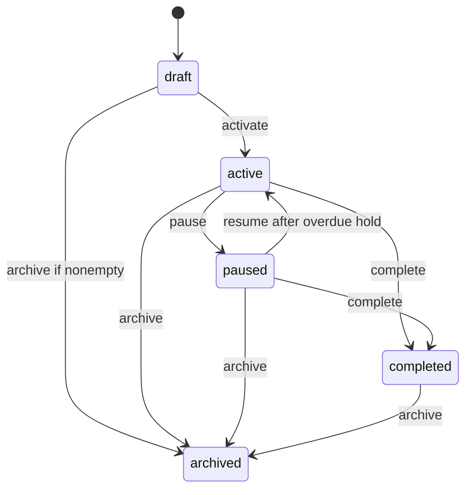
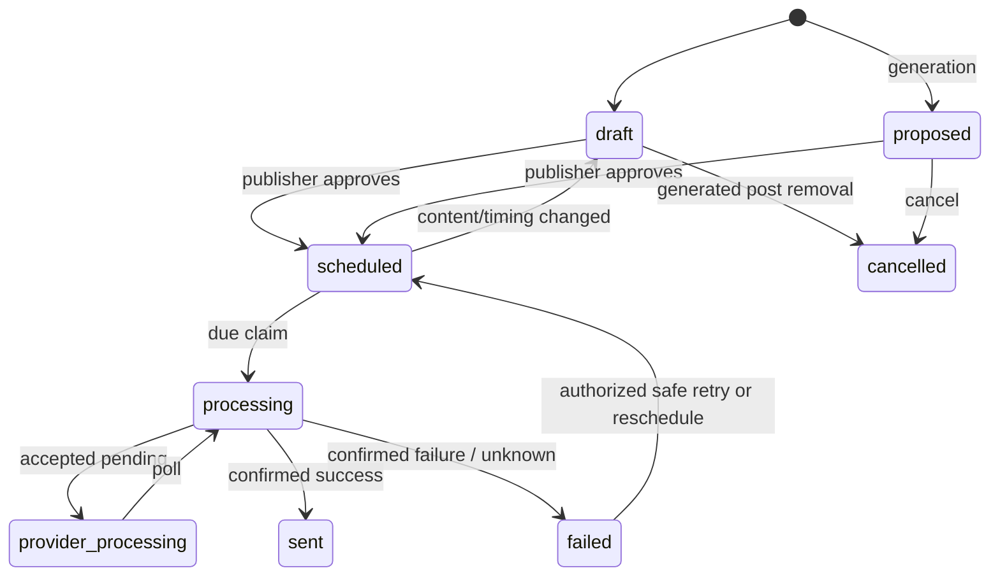

# A4 — Social campaigns functional specification

## Baseline and capability inventory

Authoritative current post consolidation is migration 032 plus 034–038, 040–041 and 044; early social docs and migrations describe replaced tables/permissions. Campaign status enum in 012 is `draft`, `active`, `paused`, `completed`, `archived`; UI `features/socialCampaigns/components/CampaignLifecycleControls.tsx` exposes activate/pause/resume/complete/remove. `actions/socialCampaigns.ts`, `features/socialCampaigns/generation/runCampaignGeneration.ts`, scheduling modules, calendar and manual-post modals implement generation, editing and review. `social_posts` stores one publication/channel, proposal/source keys, content, consent, timing, attempts, error, provider IDs and key. Migration 040 archives pending posts by cancelling and clearing schedule and consent, but preserves in-flight work. 041 uses canonical post operations for bulk actions. `app/api/cron/_cronHandler.ts` recovers stale work, claims and invokes existing providers; 036/038 define claim/polling behavior. `features/socialCampaigns/instagram/imageValidation.ts` and `ManualPostModal.tsx` require 4:5 feed and 9:16 story JPEG; there is no image generation implementation found in this checkout. `scripts/test-instagram-requirements.cjs` exists; other documented runners referenced in prior docs are absent in current checkout. `social.view/edit/publish/delete` is current permission model per migration 032 and `docs/social-permissions.md`, not the older permissions listed in `docs/social-campaigns.md`.

Repository has `.github/workflows/cron-delivery.yml`, generation and health jobs plus `docs/social-cron-github.md`. User says preserve AWS Lightsail cron: actual deployment and whether both schedulers operate are unknown. Preserve all deployed infrastructure until verified; do not add competing jobs.

| Capability | Actor/permission | Existing and remaining gap |
| --- | --- | --- |
| Standalone/event-linked create, settings | `social.edit` | Existing. Linked campaign publication prerequisites exist; no new lifecycle propagation. |
| Activate/pause/resume/complete | `social.publish` | Existing UI and status; verify each transaction. Claim requires active except provider processing; resume can claim previously overdue scheduled work, violating requested no-auto-send. |
| Generate preview/proposal | `social.edit`, backend/cron | Existing rolling generation/source dedup; verify exact guards and behavior after pause. |
| Edit/approve/schedule | edit and publish | Existing post RPCs, validation, version and consent; changes demote pending posts under existing trigger; compare against actual changes before selective invalidation. |
| Provider publish/poll/retry | worker | Existing bounded claims, attempts, key, provider IDs and processing. Unknown outcomes and stale recovery require stronger reconciliation before safe retry; don't claim universal exactly-once. |
| Manual retry | publisher | UI says reschedule after terminal failure; dedicated safe retry semantics for confirmed retryable failure not verified; design/implement only after characterization. |
| Media | editor/worker | Selection and validation exist; mandatory generated 9:16 asset not found. Trace external generator before claiming removal or modifying it; preserve story publishing. |

## State dimensions and diagrams

Campaign lifecycle is distinct from post content/consent and provider state. Current post statuses in 032 are `draft`, `proposed`, `scheduled`, `due`, `processing`, `provider_processing`, `sent`, `failed`, `skipped`, `cancelled`; confirm all enum/guards in deployed schema. A proposal is a post status, not another entity/table. Approval is `publication_consented_at/by` plus scheduling/review eligibility, not a general reusable approval. `retryable`, attempts and provider ID are separate dimensions; no verified explicit `unknown outcome` state today. Add an explicit hold/reconciliation marker only if existing fields cannot represent it safely. Sent/in-flight records remain immutable under established guards.





Diagram is conceptual: actual permitted edges must be verified against canonical RPCs; not every failed outcome is safe to retry, and skipped/cancelled have separate rules.

| Entity | Current state | Action/trigger | Preconditions | Actor/permission | Next state | Consequences | Failure behavior |
| --- | --- | --- | --- | --- | --- | --- | --- |
| Campaign | draft | activate | linked event published, validation/review | publish | active | generation/eligible schedule may run; no synchronous send | denied/conflict |
| Campaign | active | pause | revision current | publish | paused | no new normal claims; in-flight provider polling must continue | race with claim resolved by DB locking; already accepted cannot be recalled |
| Campaign | paused | resume | revision current; overdue protection applied | publish | active | proposed: atomically hold overdue scheduled/retry posts before enabling claim; require manual reschedule/reapproval | if hold fails no resume; preserve future approved work |
| Campaign | active/paused | complete | existing constraints to verify | publish | completed | generation and new ordinary claims stop; in-flight reconciles; retain history | stale/conflict |
| Campaign | any nonarchived | archive/delete | empty draft delete or archive | delete | archived/deleted | 040 cancels pending and clears timing/consent; in-flight survives | local transaction failure rolls back |
| Post | no post | generate proposal | eligible campaign/event, slot, source identity | edit/worker | proposed | source+channel uniqueness avoids duplicate generation; no provider call | concurrency rejected/suppressed; audit |
| Post | draft/proposed/scheduled | edit | valid, revision; sent/inflight prohibited | edit | draft/proposed as canonical RPC | material content or timing change invalidates relevant consent; unchanged should preserve it after verified comparison | conflict/validation |
| Post | draft/proposed | approve | active campaign, no outstanding review, future valid slot, platform requirements | edit+publish where saving; publish for approval RPC | scheduled | immutable approver/consent and due time; no immediate send | stale or validation rolls back |
| Post | scheduled | becomes due / claim | campaign active, consent, eligible, retryable and due | worker | processing | transactional claim/attempt and idempotency key; provider call after commit | concurrent claims skip locked |
| Post | processing | provider accepts async | provider ID | worker | provider_processing | retain provider ID and poll without consuming send attempt | save failure becomes unknown, reconcile |
| Post | processing/provider_processing | confirmed success | provider result | worker | sent | retain sent history and provider ID | state-write failure requires reconciliation, not blind retry |
| Post | processing | confirmed failure | classified provider error | worker | failed | bounded retry when demonstrably safe; terminal notification | ambiguous failure → hold for reconciliation |
| Post | failed | manual safe retry | known safe, active campaign, permission and approved unchanged content | publish | scheduled/processing by existing path | retain attempt audit and key; protect against duplicate claim | reject unknown or stale; manual reconcile first |
| Post | pending | cancel/skip | existing RPC rules, not inflight/sent | publish/delete as applicable | cancelled/skipped | release slot when applicable, preserve generated identity; no recall | failure leaves state intact |
| Post | unknown | reconcile | inspect provider ID/account and evidence | publish | sent / failed / held | audit decision/evidence, do not blindly send | remain held if evidence inconclusive |

Approval invalidation is scoped to changed authoritative content/timing and their relevant eligibility. Existing 040 trigger can demote many posts when campaign settings/event review changes; changing this requires tests proving unchanged posts remain genuinely valid. For overdue pause/resume, the `claim_social_posts` active-campaign guard alone is insufficient: after resume it can claim `next_attempt_at <= now()`. Proposed transactional resume holds such posts with a review reason and clears automatic due eligibility, preserving history and requiring a new future time and approval. Provider-processing polling continues even while held so an accepted external request is not duplicated. Treat retries already attempted before suspension conservatively; reconcile first if provider outcome is ambiguous. Decide whether hold retains future consent or revokes it when timing changes; recommended retain future-only consent and require renewed consent for rescheduling.

## Media, screens and interactions

Generated image output requirement is 4:5 JPEG. The checked repository only selects/uploads finished media; generator location and 9:16 generation requirement are unverified. Find actual generator before altering it. Current story validators explicitly enforce 9:16, so simply removing generation of a second image makes 4:5 unusable for stories under current rules. Preserve existing 9:16 story upload/publishing; investigate provider support for 4:5 story media and product crop/pad expectations before altering validation. Do not assert compatibility without provider tests. Feed remains 4:5 with alt text; Instagram Story remains 9:16 until the decision and provider acceptance tests.

```text
Social > Campaigns [New]  [Draft | Active | Paused | Completed | Archived]
Campaign [Settings] [Calendar / proposals] [Review] [History]
  Paused: 2 overdue posts held [Review overdue]  [Resume]
Calendar post → editor: content + media + schedule [Save draft] [Approve]
Status: Provider processing / Sent / Failed / Outcome unknown
  [Inspect evidence] [Retry safely] / [Mark reconciled] (authorized)
```

| Screen | Goal / states / data | Inputs, CTA → transition | Permission / validation / feedback |
| --- | --- | --- | --- |
| Campaign list and workspace | standalone/linked, lifecycle, review, calendar | create, settings, activate/pause/resume/complete/archive | view/edit/publish/delete; confirm archive and show overdue/inflight implications. |
| Generation preview | inspect proposed slots and suppression | generate/recalculate | edit; current campaign/event revisions and unique source; show partial failures without implying publish. |
| Post editor/approval | content, media, scheduled slot, draft/proposed/approved | save, approve, change schedule, cancel | edit/publish; channel-specific validation, stale conflict, timezone, no implicit send. |
| Delivery / history | scheduled, processing, pending, sent, failed or unknown, attempts and safe provider identifiers | safe retry, reconcile, open provider where permitted | publish; classify unknown vs retryable, permission denied/empty/failure; sent history immutable. |

## Data, operations and migration

Existing campaign `id,event_id,status,version,needs_review,generated_through,next_generation_at` determines lifecycle and generation. Existing post `id,campaign_id,version,status,channel,source_schedule_id,source_date,reminder_milestone` ensures identity and source dedup; content fields and `scheduled_date,time_slot,scheduled_at` support editor and timing; `publication_consented_at/by` and `needs_review` guard approval; `attempt_count,next_attempt_at,retryable,provider_error,external_id,idempotency_key,provider_processing_started_at` support worker and reconciliation. Each is owned by canonical server/RPC paths and is versioned/retained as defined in 032/036/038/040/044; inspect exact constraints and retention before extending. Due and slot indexes already exist; benchmark changes to overdue hold/claim using actual query plans. If unknown outcome cannot safely be represented with existing fields, propose a constrained nullable reconciliation reason/status and auditable decisions, not duplicate delivery records. Source and sent identifiers remain immutable; no sensitive provider responses in logs.

`transitionCampaign(id,expectedVersion,action)`, `savePost(id,expectedVersion,content,timing)`, `approvePost`, `holdOverdue`, `retryConfirmedFailure`, and `reconcileOutcome` are conceptual typed operations building on existing RPCs; some are new and subject to approval. Each locks campaign/post in consistent order, verifies permissions/revision, updates state and audit atomically, and returns current status/counts. Provider side effects remain in existing provider execution; use stable provider idempotency or reconciliation and never infer a send from a claim. Retain schedule enforcement and existing provider-specific credential, processing and retry logic; no new scheduler.

## Scenario and traceability

Campaign paused before 09:00 send → existing worker stops new claims → at 10:00 publisher resumes → one transactional operation holds overdue post and activates campaign → screen reports held post → publisher chooses future slot and reapproves → worker sends at new due time. If a claim was already in flight before pause, it completes/reconciles; pause cannot recall it. If provider accepted but state save failed, show unknown and require provider evidence before retry.

| Requirement → capability/state/transition → consequence → screen → data/API → test |
| --- |
| Campaign lifecycle → active/pause/resume/complete/archive → future work held or cancelled, in-flight reconciled → controls → campaign RPC/claim → concurrent pause/claim, overdue resume, archive. |
| Proposal & approval → proposed/edit/approve → revision-specific consent → calendar/editor → save/approve RPC → changed vs unchanged, denied, stale, slot rules. |
| Provider processing/failure → claim/poll/success/fail/unknown → immutable history and safe retry → delivery view → existing worker and minimal hold → injected timeout, crash after accept, duplicate claim/poll, failure and reconciliation. |
| 4:5 generated output/no required 9:16 generation → generator output → preserve separate story publishing → media editor → generator contract/validation → **generator not found; verify owner and compatibility before implementation**. |
| Preserve Lightsail and existing providers → existing cron → no competing job → operations docs → deployment config → **deployment not inspected; GitHub workflows also present**. |
